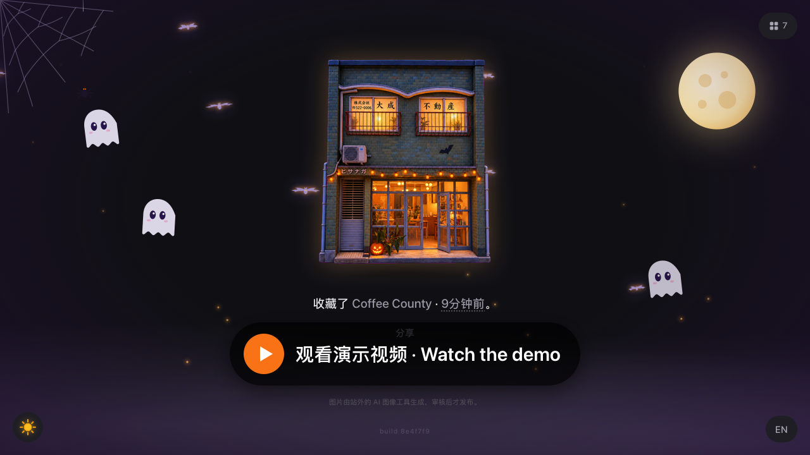

# Halloween Check-in

**English** | [中文](README.zh-CN.md)

<p align="center">
  <a href="https://halloween-checkin.a512884335.workers.dev"></a>
  <a href="https://youtu.be/9htWZpw9GGM"></a>
</p>

<p align="center"><b>👉 Live demo: <a href="https://halloween-checkin.a512884335.workers.dev">https://halloween-checkin.a512884335.workers.dev</a></b></p>

Turn the places you've been into collectible miniature buildings that light up as the sky darkens. Say `checkin`, add `Halloween`, and the same building changes into a Halloween costume.

[](https://youtu.be/9htWZpw9GGM)

- **Demo video**: https://youtu.be/9htWZpw9GGM (click the image above to play)
- **Live demo**: https://halloween-checkin.a512884335.workers.dev (toggle Day / Halloween Night at the bottom-left; click a photo to see the timeline)
- **Host your own**: [docs/SELF_HOST.md](docs/SELF_HOST.md) — step by step, about 15 minutes; or hand that document to your ChatGPT / Kiro and let it walk you through it
- **How it was built with Kiro**: see "Kiro development notes" below

Built for the AWS "Kiro Wacky Ideas" online challenge.

## How to use

In an AI chat that can generate images (ChatGPT, Codex, etc.), upload a photo you took of a place and say:

```
checkin Halloween
```

The Skill will:

1. Generate a regular daytime miniature of the building from your photo, then — using only that daytime image — generate the Halloween night version of the same building (a few small decorations added, lighting changed to night);
2. Cut out the background, with both images sharing one composition (exactly the same size and position), output two 720×720 transparent PNGs, and run automatic checks;
3. Show you the exact two images, the caption, and a list of differences (e.g. "added a pumpkin") for review, then **stop**;
4. Publish to the website only after you explicitly say "publish".

The website has exactly two modes, switched by one button at the bottom-left. The button shows **the mode you will switch to**: during the day it shows a jack-o'-lantern head (switch to Halloween Night); at night it shows a sun (switch back to Day). **Day** shows the regular version; **Night** shows the Halloween version, plus Halloween atmosphere: a moon, flocks of bats flying across it, a little ghost drawn after Kiro's mascot (its eyes follow your pointer, it blinks, and now and then one peeks out from behind a building), a spider dangling on a thread, cobwebs in the corners, fog and embers. If a place doesn't have a Halloween version yet, Night shows its regular night image (earlier imports have one), or the day image if there is none. The site opens in Halloween Night by default; your choice is kept for the rest of the browsing session.

Click the big image, or the time in its caption, and the image flies into a timeline that spans the screen: all places arranged by time from left to right (newest at the far right), joined end to end so you can keep scrolling forever, with a neighbouring place always on both sides. Swipe, drag with the mouse, use the scroll wheel or ←/→ to browse; the centre image is the largest. Click an image to return to the big view; click empty space or press Esc to return to the centre image. The big view itself uses the browser's native horizontal scrolling with snapping (also joined end to end, like the timeline): a finger swipe gets the system's own scrolling and inertia, stopping on one image at a time; while scrolling, the buildings on either side shrink slightly and fade, and captions fade with distance and swap to the next place once out of sight. You can drag with the mouse, scroll horizontally on a trackpad, or use ←/→. A button at the top-right expands a grid of all places; press it again to return to the previous view.

## Use it in ChatGPT (plugin = Skill + MCP hosted on Cloudflare)

The whole chain happens inside ChatGPT: ChatGPT generates the images on your subscription, the Skill cuts them out and validates them in its sandbox, and the plugin's MCP tools hand the finished work to a Cloudflare Worker. Nothing is public until you say "publish".

1. **Add the MCP server**: chatgpt.com → Plugins → ＋ → Add custom MCP server
   - Server URL: `https://halloween-checkin.a512884335.workers.dev/mcp`
   - Authentication: OAuth (no client id needed — ChatGPT registers automatically)
   - Choose Create as a plugin, then install the plugin.
2. **Authorize**: ChatGPT opens this site's authorization page. Enter your owner token (the `HC_TOKEN` in your local `.env.local`) and click Allow. Only ever enter the token on that page — never paste it into a chat.
3. **Add the Skill**: first run `npm run chatgpt:zip`, which produces two files; pick one:
   - `chatgpt-skill/dist/halloween-checkin-plugin.zip`: the full plugin package (`plugin.json` + `mcp.json` + `skills/`), upload it under **Plugins**;
   - `chatgpt-skill/dist/halloween-checkin-skill.zip`: the Skill only, upload it under **Skills** (add the MCP separately, per step 1).
   Uploading the Skill-only zip under Plugins will fail with "cannot add plugin", because a plugin package must include `plugin.json`.
4. **Use it**: start a new chat, pick this plugin with `@`, upload a photo and say `checkin Halloween`. It produces two images (regular daytime, Halloween night), cuts them out, validates them, shows you the review package and stops; it publishes only when you say "publish".

Tools: `submit_checkin_for_review` (registers for review only, publishes nothing), `publish_checkin` (approves by the hash from review time and publishes; safe to retry), `get_checkin_status`, `list_checkins`. The tools only accept HTTPS files hosted on ChatGPT's file-storage domains, re-check every redirect hop, and enforce size limits. OAuth records live in this project's own D1 (`hc_oauth_kv`).

## Architecture

```
Host AI (Skill)                     Cloudflare Worker                     Website
Photo + checkin [Halloween]           POST /api/revisions   register rev.    GET /api/checkins
→ host generates images (your sub.)   PUT  …/media/day|night upload bytes    GET /media/<rev>/<day|night>.png
→ npm run prepare:images              POST …/approve        bind hash+target (only published safe fields returned)
→ npm run hc -- review / submit       POST …/publish        idempotent publish
→ review; wait for your "publish"     D1: records/revisions/approvals/ops   R2: immutable images
```

- Image generation happens only in the host; the website and backend never call any image-generation service.
- An approval binds the revision, the content hash and the publish target; it expires in 30 minutes and can be revoked. Any change creates a new revision and invalidates old approvals.
- Publishing is idempotent: replaying the same idempotency key returns the same result; the same key with different content is a conflict; a revision can be published at most once.
- Images are written first, then the record is committed atomically once. If the commit result is uncertain, recover with the same key — it will never double-publish.
- The regular and Halloween versions are stored separately in the data and never overwrite each other; the UI binds them to the two modes (Day = regular, Night = Halloween). Place, capture time and companions may be empty, and empty means empty: when the capture time is unknown, the site writes "Added … · 3 days ago" and notes that this is the publish time, not "Spotted at".

## Animation

- Entrance: the model drops in with a spring; caption text fades in paragraph by paragraph.
- Hover: the model tilts in 3D with the pointer; the specular highlight lands only on the building's silhouette (using the image itself as a mask) and springs back when the pointer leaves.
- Day/Night: switches with a circular reveal from the button position (View Transitions); night windows glow warm.
- Regular/Halloween: the model flips like a cardboard standee and changes costume.
- Flying: transitions between the big view and the timeline/grid are spring-driven, flying along an arc, slightly enlarging, tilting and casting a shadow in flight, with a small bounce on landing.
- Timeline: places on both sides slide in from the centre outward; the further from the centre, the smaller and fainter, turned slightly toward the middle; dates and place names have a slight parallax. Dragging and releasing glides with inertia, then settles on the nearest image.
- Changing place (wrapping around at the ends): the model slides out from its current position (including where a finger dragged it) and the new one springs in from the other side; the caption slides in paragraph by paragraph in the same direction.
- Text: when switching between the big view and the timeline, the place name is one single element flying — growing from the timeline label into the name under the big image, or shrinking back into the label; other text fades out first, then fades in paragraph by paragraph. All text animation uses only translation and opacity, no blur filters.
- Smoothness: the timeline is built ahead of time while idle and pre-rendered once, so opening it doesn't drop a frame; night decorations are added after the day/night reveal animation finishes.
- Switching to Night pops little pumpkins and embers out of the building; in the mode button the sun spins out and the pumpkin head pops in. Pressing the model squashes it slightly and it springs back.
- Clicks and key presses during an animation are not lost; they run after the current animation ends.
- All places: the big image flies into its position in the grid, and flies back on return; the grid fades in item by item.
- Night atmosphere: the moon rises and slowly breathes with a glow; bats (with orange outlines, visible at night) flap across on random paths, a few deliberately crossing the moon; little ghosts drift at the sides, blink, and look toward the pointer, with one occasionally peeking from behind a building; a spider swings up and down on its thread; fog drifts, embers rise, and candlelight flickers beneath the buildings. All decorations sit behind the content and never cover buildings or text.
- When switching views, text and other images fade out first, and the switch happens in the same frame once the image to show is confirmed decoded, avoiding a flash on Safari.
- Everything is disabled when the system has "reduce motion" turned on.

## Running it

Requires Node ≥ 22.12.

```bash
npm ci
npm run verify       # all tests + build
npm run e2e:local    # run the full chain locally in workerd (local D1/R2 simulation, no Cloudflare connection, synthetic assets)
npm run dev          # view the pages only (shows a load failure without a backend)
```

Publish one entry (needs the backend URL and the owner token; keep the token in environment variables only):

```bash
export HC_API_URL=https://…  HC_TOKEN=…
npm run prepare:images -- --day raw-day.png --night raw-night.png --out-dir prep
npm run hc -- review --day prep/day.png --night prep/night.png --theme halloween --text "at …" --out ws
npm run hc -- submit  --dir ws      # register and upload; nothing is public yet
npm run hc -- approve --dir ws      # only after you explicitly ask to publish
npm run hc -- publish --dir ws      # publish, and verify the public images' status, type and byte hashes
```

Deployment records and steps: see [docs/DEPLOY.md](docs/DEPLOY.md).

## Tests

`npm test` covers: canonical hashing and input validation; the state machine; approvals (missing, expired, revoked, wrong target); publishing (duplicate, concurrent, same key with different content, failure before commit, response lost after commit, second image upload failure, batch rollback); permissions (anonymous, wrong token, someone else's draft); privacy (no private fields in the public API, unpublished images unreachable); PNG structure checks (signature, CRC, truncation, trailing data, unknown critical chunks, decompression bombs); image preparation (multiple background colours, built-in transparency, preserving internal same-colour detail, speckle removal, shared composition, rejecting messy backgrounds); website display logic and springs; page scripts read-only; Skill/command consistency; and the Cloudflare remote-operation guard.

Database tests use a `node:sqlite` stand-in and object storage an in-memory stand-in; `npm run e2e:local` runs in the real Workers runtime. Concurrency is only tested within a single process; contention in production has not been load-tested.

## Current state and limitations (honestly)

- The Skill has not yet been run with real photos in a real host; the prompts and image preparation have only been validated with synthetic assets, so the first real generation may need adjustments.
- The ChatGPT plugin (OAuth + MCP) is fully protocol-tested in a local real runtime (registration, authorization, token exchange, refresh, tool calls, authorization-code reuse revokes), but it has not yet been connected in your actual ChatGPT account; the details of how ChatGPT passes files to tools follow what actually happens.
- Approval is an agent declaration (see above); there is no web confirmation button.
- There is no rate limiting, and no replace, rollback or delete functionality.
- Visual checks (signage, structure, whether the night version is the same building) are done by the agent and you; scripts only do mechanical checks.
- Pages have been visually checked in a browser; there is no automated browser testing or screen-reader testing.

## Kiro development notes

- `.kiro/specs/halloween-checkin/`: requirements, design, tasks. The first drafts of the requirements and design came from a design handoff package; implementation decisions and task check-offs were updated in Kiro to match what was actually completed.
- `.kiro/steering/project.md`: project constraints.
- `.kiro/hooks/`: require confirmation before remote/destructive wrangler operations (`scripts/guard-cloudflare.mjs`); run tests when source files are saved.
- This repository's code, tests, Skill copy and prompts were written in Kiro. The earlier development process lives in the author's private development repository.
- Image generation is not a Kiro capability: in the real flow, the images are generated by the host AI.

## Credits and sources

- The little ghost in Night mode is an SVG redrawn for this project after Kiro's ghost mascot; it is not an official Kiro logo file. No public Kiro brand-usage guidelines could be found; confirm the brand rules before using any official logo.

- The idea — "one line on a homepage saying where I am lately, with a small picture of the place" — comes from designer [Peng Zheng's personal homepage](https://www.pengzhe.ng/), and from the author's earlier August Check-in inspired by it. This repository's code, styles, copy, prompts and assets were all written fresh for this project; nothing was copied from them.
- Dependencies: [Astro](https://astro.build), [sharp](https://sharp.pixelplumbing.com), [Wrangler](https://developers.cloudflare.com/workers/wrangler/).
- The demo assets are synthetic little houses drawn in code and do not correspond to real places.

## License

The code is released under the [MIT](LICENSE) license. The building images shown on the live site were generated with AI image tools and are not covered by the code license.
